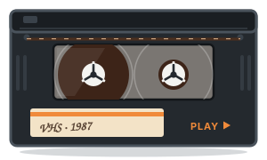
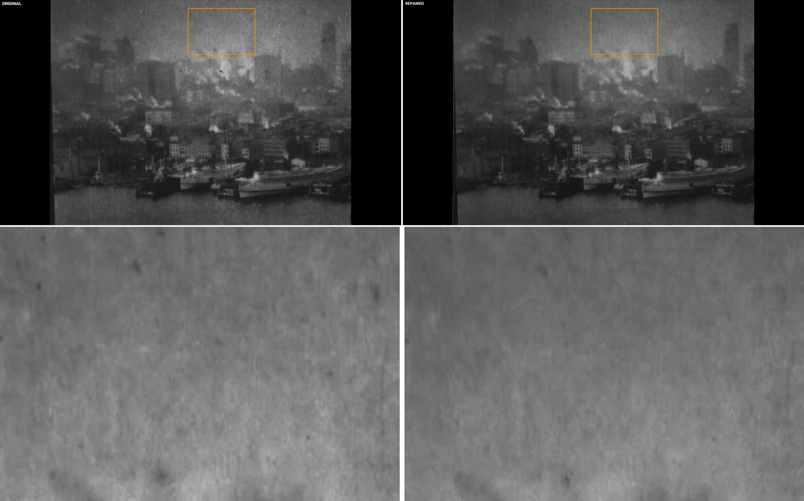
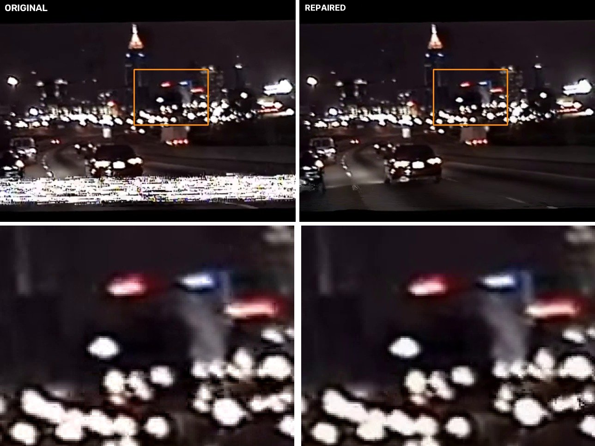
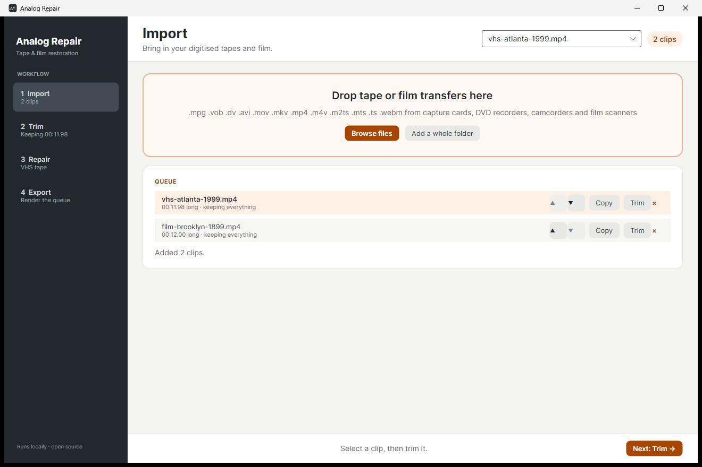
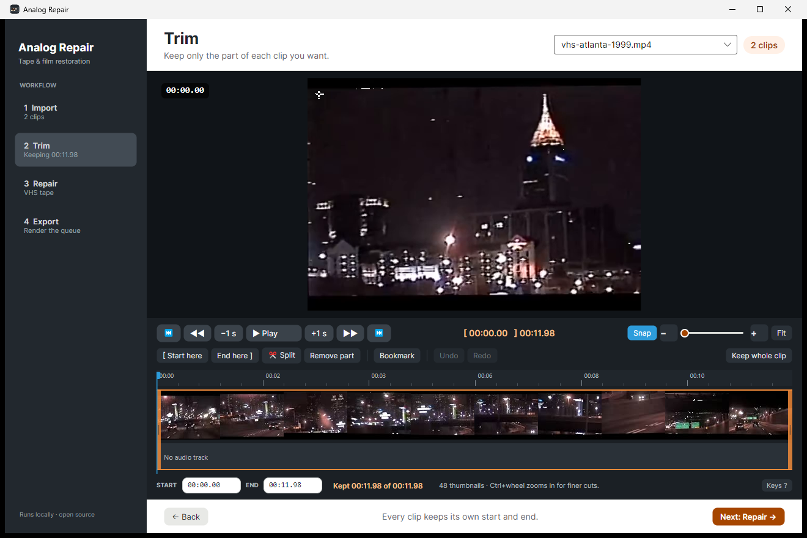
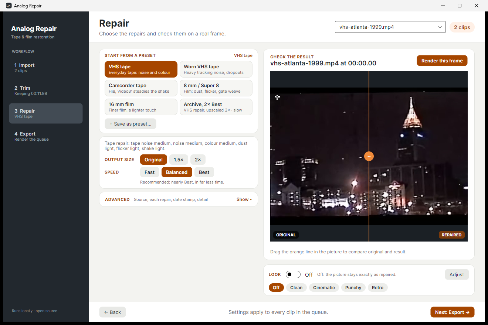
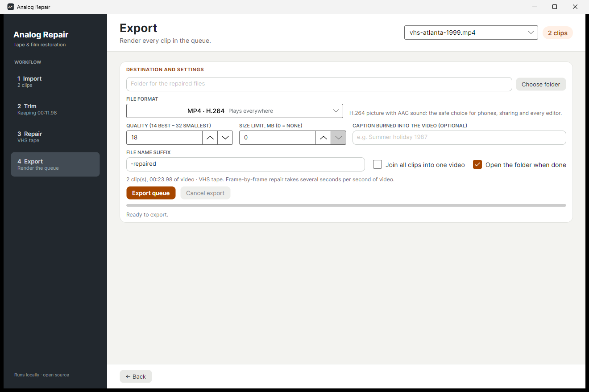
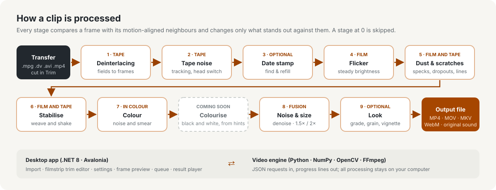

> [!IMPORTANT]
> ### Want to stay up to date? Download the launcher.
> **The launcher always gets you the newest Analog Repair.** Pick your system, and it downloads the latest release into its own folder (or a folder you choose), checks it, deletes the old version and starts the app.
>
> **[⬇ Launcher for Windows](https://github.com/Bratwurstexe/ANALOG_REPAIR/releases/latest/download/Analog-Repair-Launcher-windows-x64.exe)**&ensp;·&ensp;**[macOS Apple Silicon](https://github.com/Bratwurstexe/ANALOG_REPAIR/releases/latest/download/Analog-Repair-Launcher-macos-apple-silicon.zip)**&ensp;·&ensp;**[macOS Intel](https://github.com/Bratwurstexe/ANALOG_REPAIR/releases/latest/download/Analog-Repair-Launcher-macos-intel.zip)**&ensp;·&ensp;**[Linux](https://github.com/Bratwurstexe/ANALOG_REPAIR/releases/latest/download/Analog-Repair-Launcher-linux-x64.tar.gz)**


<div align="center">



# Analog Repair

[](LICENSE)
[](https://github.com/Bratwurstexe/ANALOG_REPAIR)
[](#getting-started)
[](https://dotnet.microsoft.com)
[](https://www.python.org)
[](https://github.com/Bratwurstexe/ANALOG_REPAIR/stargazers)
[](https://github.com/Bratwurstexe/ANALOG_REPAIR/releases)

**Open-source restoration for digitised tapes and film.**
Repairs VHS, S-VHS, Hi8, Video8 and camcorder tapes and 8 mm, Super 8 or 16 mm film: tracking noise, wobbling lines, dust, scratches, flicker, shake, smeared colour and a burned-in date stamp. Then it calms the noise and, if you like, upscales the result. Everything runs on your own computer.
**Uses your processor and graphics card together, automatically:** the heavy pixel work runs on the GPU (NVIDIA, AMD, Intel or Apple), everything else on all CPU cores.

<h2><a href="https://github.com/Bratwurstexe/ANALOG_REPAIR/releases/latest">⬇ Download for Windows, macOS and Linux</a><br><sub>Ready to run, no Python or FFmpeg setup.</sub></h2>

<hr>

<p align="center"><a href="#features"><b>Features</b></a>&ensp;·&ensp;<a href="#before-and-after"><b>Before / after</b></a>&ensp;·&ensp;<a href="#the-app"><b>The app</b></a>&ensp;·&ensp;<a href="#how-it-works"><b>How it works</b></a>&ensp;·&ensp;<a href="#the-workflow"><b>Workflow</b></a>&ensp;·&ensp;<a href="#getting-started"><b>Getting started</b></a>&ensp;·&ensp;<a href="#coming-soon"><b>Coming soon</b></a>&ensp;·&ensp;<a href="#licence"><b>Licence</b></a></p>

<hr>

</div>

For drone footage, see the sister project [FPV DVR Cleaner](https://github.com/Bratwurstexe/FPV_DVR_CLEANER).

---

## Features

- **Start from a preset.** The *Repair* page opens with presets for your footage: *VHS tape*, *Worn VHS tape*, *Camcorder tape*, *8 mm / Super 8*, *16 mm film* and *Archive, 2× Best*. Every repair keeps its own slider under *Advanced*, folded away until you need it.
- **Tape noise repaired.** Rows torn by tracking noise are rebuilt from the frames around them, the torn band at the bottom of a VHS picture (the head switch) is masked, and lines that wobble sideways are put back in place.
- **Dust and scratches removed.** Specks of dirt, tape dropouts and thin vertical scratches are refilled from the neighbouring frames.
- **Flicker evened out, shake steadied.** Brightness that jumps from frame to frame is matched to its neighbours; slow changes of exposure stay. Gate weave and a shaky hand are smoothed; pans and zooms stay.
- **Colour repaired.** Colour noise is re-estimated from the frames around, and the colour that tape smears sideways past every edge is pulled back onto it. Black-and-white footage is left alone.
- **Date stamp removed.** A burned-in camcorder date and time is found by its parts that hold still while the picture moves, and painted out from frames where the scene behind it is visible. *Show* marks what would be removed.
- **Interlaced transfers handled.** Tapes captured as fields are turned into full frames before anything else.
- **Noise reduction that keeps the film.** Five motion-aligned frames are fused around a robust median. *Keep film grain* leaves some of the grain in, so film does not look waxy.
- **Multi-frame upscaling.** 1.5× or 2× (720 × 576 tape transfers to 1440 × 1152). Neighbouring frames add detail instead of just enlarging a single frame.
- **A finished look, if you want one.** Colour grade, glow, vignette, film grain and lens fringe, each with its own slider, or one of the presets *Clean*, *Cinematic*, *Punchy* and *Retro*. It is off by default and then changes nothing.
- **Timeline trim editor.** Split a recording at the playhead, click a part, press Delete, and the rest closes up. Drag the edges to trim, snap to cuts and bookmarks, hover to scrub, Ctrl+wheel to zoom, undo and redo. The audio track is shown as a waveform, and playback decodes the real video, so it runs smoothly.
- **Check before you export.** Render any frame through the whole chain and drag the split line across the picture to compare original and result.
- **Watch the result live.** After the export, original and repaired clip play side by side (or under a wipe you drag), frame-accurate to each other. A measurement tells you how much was gained and how much is still possible; *Auto refine* picks the settings from it and exports again with one click.
- **Pick the file format.** MP4 with H.264 plays everywhere, MP4 with H.265 gives the smallest files, MOV with ProRes 422 is made for video editors, MKV is a robust container, and WebM with VP9 and Opus is for the web.
- **Batch export.** Every clip keeps its own cut. The remaining time is shown live, you can cancel at any moment, and the original sound is kept. Clips can be joined into one video.
- **Your own presets and memory.** Save your settings as a preset with a name; rename, update or delete it later. The last settings, the export folder and the cut of every recording come back the next time you start the app.
- **Private.** No account, no upload, no telemetry. Everything runs locally.

## Before and after

Each image shows the whole picture, original on the left and repaired on the right, and below it the marked area enlarged.

**Film:** dust, specks and flicker on a 1899 film.



<sub>*Panorama from the tower of Brooklyn Bridge* (American Mutoscope and Biograph Company, 1899), [Library of Congress](https://www.loc.gov/item/00694390), public domain. Repaired with the *8 mm / Super 8* preset.</sub>

**Tape:** a night drive from a VHS camcorder tape, with a tracking-noise band at the bottom.



<sub>*Interstate 75 North – Atlanta, Georgia (1999; VHS)* by uPiNtHemTNs, [Wikimedia Commons](https://commons.wikimedia.org/wiki/File:Interstate_75_North_-_Atlanta,_Georgia_(1999;_VHS).webm), licensed [CC BY 3.0](https://creativecommons.org/licenses/by/3.0/). Shown as stills before and after the repair; the labels were added. Repaired with the *VHS tape* preset.</sub>

## The app

Four steps on the left, one screen each, and every page fits the window.

| | |
|---|---|
|  |  |
| **Import:** drop transfers or add a folder. | **Trim:** split, remove parts, fine-tune the edges. |
|  |  |
| **Repair:** pick a preset, check a real frame; *Advanced* holds every slider. | **Export:** choose folder and format, then render the queue. |

## How it works



The desktop app (.NET 8, Avalonia) is the front end: import, trimming, settings, preview and the export queue. All video work happens in a Python engine built on NumPy, OpenCV and FFmpeg. The two talk through small JSON requests and progress lines, so the engine can also be used and debugged on its own.

Old footage fails in its own ways. Every stage compares a frame with its motion-aligned neighbours and changes only what clearly stands out against them; each one is off at 0, and on a clean clip almost nothing changes. Transfers often store a film frame two or three times, and those copies carry the same dust and flicker, so the stages compare with the nearest frame that really is different. The stages run in this order:

1. **Deinterlacing.** A transfer recorded as fields is woven into full frames by FFmpeg's bwdif filter before anything else. It is recognised by the field order in the file or, when the file claims to be progressive, by comb teeth in moving parts.
2. **Tape noise.** A row that is far from the median of the aligned neighbours and full of fine dots is tracking noise and is rebuilt from them, with the motion carried in from the rows around it. When that band sits at the bottom of most frames for a second, it is the head switch, and it is masked black. Each line is then matched sideways against the neighbours; the shift counts only when the left, middle and right of the line agree on it, as they do for a time-base error and not for motion.
3. **Date stamp.** At the edge of burned-in text the brightness gradient points the same way in every frame, while scene edges point in all directions as the camera moves. Comparing summed gradient *vectors* with summed gradient *lengths* marks edges that hold still; they are grouped into lines of text. Seconds that tick sit inside the same line and go with it. Each region is filled from the neighbouring frame whose aligned content fits its rim best, with the brightness corrected; where no frame shows the background, it is inpainted. This runs before stabilising, while the stamp is still where it was found.
4. **Flicker.** The brightness of each frame is fitted to the median of its aligned neighbours from the same shot, as a gain and an offset that may change gently across the picture. A slow change of exposure survives, because the median follows it.
5. **Dust and scratches.** A spot brighter or darker than everything near it in both aligned neighbours, while those two agree, is dirt and is refilled from them. Large or crowded "spots" are motion the alignment missed and are left alone. A thin line that stands out from both sides over three quarters of the rows, in most frames, and does not move with the picture is a scratch and is filled across.
6. **Stabilising.** The motion between frames is chained into a path per shot and smoothed with a straight-line fit over up to half a second, so pans and zooms stay and the weave goes. The black surround and the edge of the film frame stay where they are; the gap the moved picture leaves is filled from neighbouring frames.
7. **Colour.** The colour of every frame is re-estimated from three earlier and three later frames, aligned with optical flow and weighted by how well their brightness matches, with a robust (Cauchy) average; the brightness is never touched. Then the colour that tape smears sideways past every edge is taken from just beyond the smear, on the side whose brightness matches. Black-and-white footage skips this step.
8. **Noise reduction and upscaling.** The current frame and two frames on each side are aligned onto the same grid, enlarged with Lanczos first if upscaling is on. The per-pixel median of the five values is the reference; every value is weighted by its distance to it, so random grain averages out while the original pixel is kept wherever the aligned frames disagree, and nothing ghosts. A mild, clipped detail lift follows. With *Keep film grain*, 30 % of the grain is left in.
9. **Look (optional).** The last step before the encoder: a gentle grade, a glow from the brightest parts, red and blue scaled slightly apart towards the edges like a cheap lens, a vignette and film grain. The grain is seeded with the frame number, so exporting the same cut twice gives the same file. When the look is off, this step does not run at all.

The output is H.264 MP4 with the original sound unless you pick another format: H.265 MP4, ProRes 422 MOV (with uncompressed sound), H.264 MKV or VP9 WebM (with Opus sound). Results are written to a temporary file and only renamed when the export succeeds.

**What it cannot do.** Analog Repair repairs what neighbouring frames can replace. Picture content that is missing in *every* nearby frame cannot be recovered. Dirt that stays on the film for several frames, a scratch that wanders across the picture, flicker within a shot of two or three frames and the bottom band of a tape whose head switch is torn in every frame (it is masked, not rebuilt) stay visible or are only reduced. Fast whip pans can stop the stabiliser for a moment. A date stamp on a tripod shot, where the scene behind it never shows, is inpainted and may leave a soft patch. Detail that the tape or the film never recorded is not invented: upscaling makes the picture larger and cleaner, not sharper than its source.

### How it stays fast

- **Every core works.** Each stage builds a frame only from its input neighbours, never from its own earlier output, so frames are processed side by side on a shared thread pool while the order is kept.
- **The graphics card takes the heavy part.** In noise reduction and upscaling, optical flow is measured on small frames on the CPU threads; warping the neighbours, the median and the weighting at full resolution run on the GPU through OpenCL, which NVIDIA, AMD, Intel and Apple drivers provide. At start a short self-test compares the GPU with the CPU; if it fails, or no GPU is found, the CPU does everything, with the same result to within one grey level. `ANALOGREPAIR_GPU=0` turns the GPU off.
- **Only the picture.** Black side or top bars of a transfer are found once per cut, skipped by every stage and added back as clean black.
- **Fast / Balanced / Best** sets how many neighbouring frames are used, how finely motion is followed and how fast the encoder runs. Expect a few minutes of processing per minute of footage with every repair switched on; it depends on your processor and graphics card.

## The workflow

1. **Import:** drop transfers onto the window or add a folder. Tapes and film usually come as .mpg, .vob, .dv, .avi, .m2ts, .mts, .mov, .mkv, .webm or .mp4.
2. **Trim:** split the recording at the playhead (`S`), click the parts you don't want and press `Delete`; the kept parts close up. Drag the `[` `]` edges to fine-tune, set bookmarks with `B`, play through the kept parts with `Space`.
3. **Repair:** pick the preset that fits your footage, then the output size and speed and, if you like, a look, and press *Render this frame* to check the result. *Advanced* shows the source (*Tape* or *Film*), every repair slider, *Remove date stamp* and *Detail*; changed values show as *Custom*, and *Save as preset…* keeps them under a name of your own.
4. **Export:** choose a folder and a file format, then start. Afterwards, play original and result side by side, read the gain and headroom estimate, and press *Auto refine* to export again with settings chosen from it.

## Getting started

### Download

**Easiest: the launcher.** Download the launcher for your system (links at the [top of this page](#analog-repair)), put it in a folder of your choice and start it. Your system is detected and preselected, but you can pick another one. It downloads the newest release, verifies its SHA-256 checksum, unpacks it next to itself, removes the old version and starts the app. Start it again whenever you like: it updates only when there is something new. You can choose another install folder at any time; the choice is remembered.

Or get the package for your system from the **[latest release](https://github.com/Bratwurstexe/ANALOG_REPAIR/releases/latest)** yourself. It contains the app, the video engine and FFmpeg. Unpack it and start it; nothing else has to be installed.

| System | File | Start |
|---|---|---|
| Windows 10/11 (64-bit) | `Analog-Repair-…-windows-x64.zip` | `AnalogRepair.Desktop.exe` |
| macOS, Apple Silicon | `Analog-Repair-…-macos-apple-silicon.zip` | `Analog Repair.app` |
| macOS, Intel | `Analog-Repair-…-macos-intel.zip` | `Analog Repair.app` |
| Linux (x64) | `Analog-Repair-…-linux-x64.AppImage` | `chmod +x` the file, then start it |
| Linux (x64), plain folder | `Analog-Repair-…-linux-x64.tar.gz` | `./AnalogRepair.Desktop` |

On Windows, SmartScreen may warn about an unknown publisher: choose *More info → Run anyway*. On macOS the app is not notarised: right-click it and choose *Open* the first time. The launcher gets the same one-time questions (on macOS: right-click *Analog Repair Launcher.app* → *Open*; on Linux: unpack it and start `Analog-Repair-Launcher`); the app it installs then starts without them. On Linux the app needs an X11 or XWayland session.

Settings are kept in `Analog Repair` under your user's local application data folder (`%LOCALAPPDATA%` on Windows, `~/.local/share` on Linux, `~/.local/share` or `~/Library/Application Support` on macOS).

### Requirements (run from source)

- Windows 10/11, Linux or macOS
- [.NET 8 SDK](https://dotnet.microsoft.com/download/dotnet/8.0) (to build the app)
- Python 3.10 or newer with `pip install numpy opencv-python-headless`
- [FFmpeg](https://ffmpeg.org/download.html) and `ffprobe` on your `PATH`

### Build and run from source

```powershell
git clone https://github.com/Bratwurstexe/ANALOG_REPAIR.git
cd ANALOG_REPAIR
python -m pip install -e .
dotnet run --project desktop/AnalogRepair.Desktop
```

Run the engine tests with `python -m unittest discover -s tests -v` (with `src` on `PYTHONPATH` if you did not install the package). The launcher builds with `dotnet build desktop/AnalogRepair.Launcher`.

### Visual Studio Code

Open the folder in VS Code and install the recommended extensions (C# Dev Kit, Python).

| Action | How |
|---|---|
| Debug the app | `F5` → *Desktop app* (builds first) |
| Debug with a clip loaded | `F5` → *Desktop app with a clip* |
| Debug the engine | *Engine: unit tests* or *Engine: run one bridge request* |
| Build | `Ctrl+Shift+B` (Debug) |
| Release build | *Terminal → Run Task → build: desktop (Release, Windows x64)*, output in `dist/desktop-win-x64` |
| Tests | *Terminal → Run Task → test: engine* |

The [build workflow](.github/workflows/build.yml) produces packages for Windows, Linux and macOS from a version tag.

## Coming soon

- [ ] **Colourize black-and-white film with a few colour hints per scene:** you colour a few spots of one frame, and the colour follows the motion through the shot
- [ ] Faster exports on long tapes
- [ ] Automatic scene detection as a trim suggestion
- [ ] German user interface

Ideas and bug reports are welcome in the [issues](https://github.com/Bratwurstexe/ANALOG_REPAIR/issues).

## Licence

The application code is released under the [MIT licence](LICENSE). It uses open-source components with their own licences (Avalonia, SkiaSharp, NumPy, OpenCV, FFmpeg, the Inter typeface and others); see [THIRD-PARTY-NOTICES.md](THIRD-PARTY-NOTICES.md). No third-party models or trained weights are used; the algorithms, data structures and interface were written for this project and its sister project; see [docs/INDEPENDENCE.md](docs/INDEPENDENCE.md). The example footage is credited in [docs/media/CREDITS.md](docs/media/CREDITS.md).

---

<details>
<summary><b>Deutsch</b></summary>

**Analog Repair** ist ein kostenloses Open-Source-Programm, das digitalisierte Videobänder und Filme aufbereitet:

- VHS, S-VHS, Hi8, Video8 und Camcorder-Bänder: Bandrauschen, Kopfumschaltung, zitternde Zeilen, verschmierte Farbe
- 8-mm-, Super-8- und 16-mm-Film: Staub, Kratzer, Flackern, Bildstand
- blendet auf Wunsch die eingebrannte Datumsanzeige aus
- reduziert Rauschen und skaliert auf Wunsch hoch

Alles läuft lokal auf deinem Rechner. Der Ablauf hat vier Schritte: **Import → Schneiden (Zeitleiste) → Reparieren (mit Vorschau) → Export (mit Restzeit, abbrechbar)**.

Voraussetzungen: .NET 8, Python 3.10+ mit `numpy` und `opencv-python-headless`, FFmpeg.

</details>
